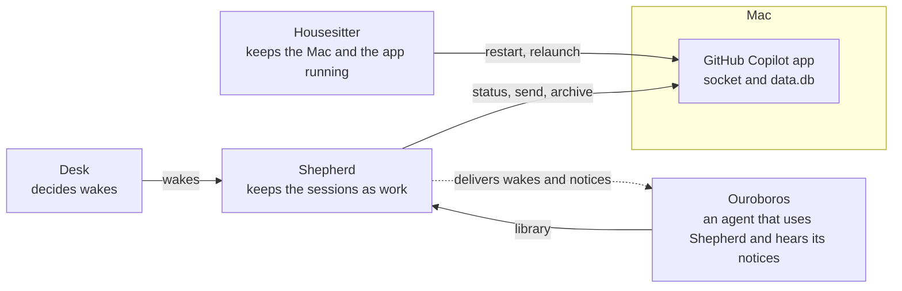

<!-- ourostack:brand:start -->
<p align="center">
  <a href="https://github.com/ourostack"></a>
</p>
<!-- ourostack:brand:end -->

# Shepherd

Keeps the flock: the GitHub Copilot app's sessions, as work.

Housesitter keeps the house: the Mac, and the app as a running process. Shepherd keeps the flock: the app's sessions. Each one is a small, separate job, and both talk to the app through the same library here.



## Duties

| Duty | Status |
| --- | --- |
| Which local sessions are busy or idle, and why | here now |
| How big each session's history is | here now |
| Send a session a message | here now |
| Archive a session or its workspace | here now |
| A safe point before a restart | moving here |
| Resume after a restart or crash | moving here |
| The 500 MB resume cap | moving here |
| Size watch and hand-off retirement | moving here |
| Stuck resume | moving here |
| Billing account and quota | moving here |
| Sidebar tidy | moving here |
| Waiting-prompt notices | moving here |
| Delivering Desk's wakes | moving here |

## CLI

```sh
npx github:ourostack/shepherd#v0.1.0 status          # one line per local session
npx github:ourostack/shepherd#v0.1.0 status --json   # the same as data
npx github:ourostack/shepherd#v0.1.0 help
```

Read-only. Exit codes: 0 ok, 1 the app's data could not be read, 2 usage.

## Library

```js
import { deps, snapshot, sendTo, archive } from '@ouro.bot/shepherd';

const d = deps();   // defaults to ~/.copilot: the database, histories, socket and clock
const sessions = await snapshot(d);               // [{ id, title, state: 'busy'|'idle', why, workspaceId, ... }]
await sendTo(d, sessions[0].id, 'carry on', 10000);
await archive(d, { ...sessions[0], workspaceType: "worktree" }, { keepWorktree: false });
```

- `deps({ copilotHome })`: the app-facing deps (`sql`, `history`, `historySize`, `exchange`, `now`, `sleep`). Tests inject fakes in their place.
- `snapshot(deps, now?, skip?)`: every local, unarchived session, with `state`, `why` and `workspaceId`.
- `sendTo(deps, id, prompt, waitMs)` and `archive(deps, row, { keepWorktree, waitMs })`: `{ ok, error }`.
- `exchange(copilotHome, messages, { done, keep, waitMs })` and `appReady(deps)`: one conversation with the app's socket.
- `loopState`, `lastTurnAt`, `continuedSince`, `tookTurnSince`, `lastReply`, `readTail`, `READY`, `DEFER`: the pure readers of a session's history.
- `ShepherdError` carries `code`, `problem` and `fix`; its message reads `<problem>. Fix: <fix>.`

Types ship in `src/index.d.ts`.

## Develop

`npm test` runs every test against fakes. Nothing touches a real app.
