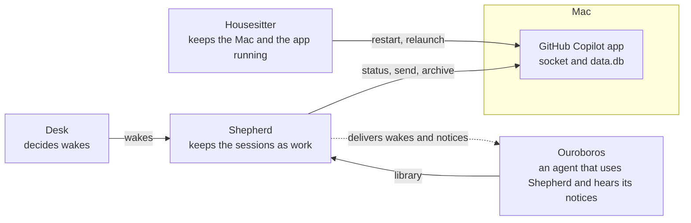

<!-- ourostack:brand:start -->
<p align="center">
  <a href="https://github.com/ourostack"></a>
</p>
<!-- ourostack:brand:end -->

# Shepherd

Keeps the flock: the GitHub Copilot app's sessions, as work.

Housesitter keeps the house: the Mac, and the app as a running process. Shepherd keeps the flock: the app's sessions. Each one is a small, separate job, and both talk to the app through the same library here.



## Duties

| Duty | Status |
| --- | --- |
| Which local sessions are busy or idle, and why | here now |
| How big each session's history is | here now |
| Send a session a message | here now |
| Archive a session or its workspace | here now |
| Compress an archived session's history (never a live one; restore-history brings it back) | here now |
| A safe point before a restart | Housesitter's restart asks, with Shepherd's `sendTo` and `lastReply` (a restart is the house's to run) |
| Resume after a restart or crash | here now |
| The 500 MB resume cap | here now |
| Size watch and hand-off retirement | here now, off until `retire.json` enables it |
| Stuck resume | here now, off until `stuck-resume.json` enables it |
| Repository trust | here now, off until `trust.json` enables it |
| The six-hour health watch | here now |
| Billing account and quota | here now |
| Sidebar tidy | here now |
| Waiting-prompt notices | moving here, with the agent's switch to the CLI below |
| Delivering Desk's wakes | here now, off until `wakes.json` enables it |

## CLI

```sh
npx github:ourostack/shepherd#v0.8.0 status                # one line per local session
npx github:ourostack/shepherd#v0.8.0 status --json         # the same as data
npx github:ourostack/shepherd#v0.8.0 restore-history <id>  # put back an archived session's compressed history
npx github:ourostack/shepherd#v0.8.0 retire plan          # what retirement and the size watch would archive, flag or ask
npx github:ourostack/shepherd#v0.8.0 watch --status        # what the health watch is following
npx github:ourostack/shepherd#v0.8.0 quota                 # each Copilot account's quota, and the balancer's last tick
npx github:ourostack/shepherd#v0.8.0 sidebar               # which projects the sidebar shows, and what apply would change
npx github:ourostack/shepherd#v0.8.0 wakes                 # each wake runner's last run and the wakes it delivered
npx github:ourostack/shepherd#v0.8.0 stuck                 # which stopped sessions a stuck resume would resume
npx github:ourostack/shepherd#v0.8.0 help
```

## For agents: the CLI contract

Each verb below takes its arguments as flags, or as one JSON object on stdin with `--input -` (keys are the flag names with underscores, for example `session_id`, `delivery_mode`, and `kickoff: { prompt, mode, … }`; a flag wins over the input). `--json` prints one line of JSON: the result, or `{ "ok": false, "code", "error" }` on failure. Exit codes: 0 ok, 1 refused or failed, 2 usage. A session id is the whole id or its first 8 or more characters.

| Verb | Flags | JSON result |
| --- | --- | --- |
| `sessions` | `[--state busy\|idle\|waiting\|stuck]` | `{ summary, sessions }`: each session's id, name, activity (`status`, `why`), coordinator, and `awaiting_input` |
| `session <id>` | | one session, as in `sessions` |
| `messages <id>` | `[--count n]` (default 6) | `{ session_id, name, state, messages: [{ at, role, text }], coverage, … }`, oldest first |
| `send <id>` | `--message <text> [--delivery immediate\|enqueue]` | `{ ok, status: accepted\|queued\|failed, session_id, name, message_id?, error? }` |
| `create` | `[--project <id\|name> \| --session-kind chat] [--name] [--workspace-type worktree\|branch] [--branch] [--prompt] [--mode] [--model] [--agent] [--reasoning-effort] [--permission-mode]` | `{ ok, created, session_id, app_url, kind, workspace_id?, error? }` |
| `answer <id>` | `--answer <text>` | `{ ok, session_id, error? }`; only a question the watch heard |
| `plan <id>` | `--approved true\|false [--action] [--feedback]` | `{ ok, approved, session_id, feedback_sent?, error? }`; only a plan the watch heard |
| `archive <id>` | `[--owner-asked]` | `{ ok, session_id, error? }`; only a session this agent created, or with `--owner-asked`, one the owner asked for, or a handed-off oversize one |
| `automation <id>` | none: read; `--clear`: remove; `--interval once\|minutes\|daily\|weekly\|cron` with `--prompt`, `--run-at`, `--every-minutes`, `--schedule-hour`, `--schedule-minute`, `--schedule-day`, `--cron-expression`, `--name`: replace | `{ ok, session_id, automations? \| automation? \| cleared?, error? }` |
| `workflows` | | `{ ok, workflows, error? }` |
| `run-workflow <id>` | | `{ ok, run?, error? }` |
| `open <id>` | | `{ ok, session_id, app_url, error? }` |

`create` records the sessions it makes, which is what lets `archive` take them without `--owner-asked`. The questions and plans that `answer` and `plan` act on are heard by the resident `watch --every`, which keeps one observer connection open; without it, `answer` and `plan` refuse. Replies to a session come back through `messages` and `session`, not pushed to the caller. The CLI archive keeps the history uncompressed.

Read-only except `restore-history`, `watch`, `install`, an applied quota tick, `sidebar apply`, `retire apply` and `wakes poll` (their own state, log and waiting files, the app's sidebar, the archive log, and, for `wakes poll`, the wakes it sends only when `wakes.json` enables them). `quota read`, `quota plan`, `quota status`, `sidebar` (plan), `retire plan`, `wakes` (status) and `stuck` (plan) change nothing. Exit codes: 0 ok, 1 the app's data could not be read, the history could not be restored, the agent could not load, or the app refused a sidebar change, 2 usage.

## Run it always

`shepherd install` writes `~/Library/LaunchAgents/bot.ouro.shepherd.plist` and loads it. The agent runs `shepherd watch --every 60 --quiet` and is kept alive, so every 60 seconds one pass runs the health watch, then the quota balancer, then the sidebar tidy (at most every `everyMinutes`), with no one at a terminal. Its log is `~/Library/Logs/shepherd-watch.launchd.log`. `shepherd install --dry-run` prints the plist and changes nothing.

The resident watch also keeps one observer connection open to hear the questions and plans sessions ask, which `answer` and `plan` need.

The health watch follows each session that a resume sent a message to, for six hours. It asks a silent, erroring or stuck session once more, and tells the agent by name only about a session that stays broken.

The same pass then runs the retire duties, once `~/.config/shepherd/retire.json` says `"enabled": true` (see Retirement). With no file it does nothing, so it never runs alongside Ouroboros' copy while that still runs. The wake runners and the stuck resume follow the same rule: each does nothing until its own config enables it (see Wakes and Stuck resume).

## Sidebar tidy

The app's sidebar lists every project, and on an always-on Mac it fills with projects nobody is working in. The rule is simple: a project shows when it is a home (a path listed in the config) or holds at least one unarchived session, local or cloud. Any other project is hidden. Showing and hiding use the app's own reversible request on its socket, and only the changes are sent.

It is off until you configure it. Write `~/.config/shepherd/sidebar.json`:

```json
{
  "enabled": true,
  "homes": ["/Users/you/code/app", "/Users/you/code/tools"],
  "everyMinutes": 30
}
```

- `enabled`: only `true` turns the tidy on. With no file, or `false`, the duty does nothing.
- `homes`: absolute paths of projects' main checkouts that always show.
- `everyMinutes`: how often the resident watch applies the tidy (default 30).

`SHEPHERD_SIDEBAR_CONFIG` overrides the file. `shepherd sidebar` (or `plan`) shows what would change and changes nothing; `shepherd sidebar apply` makes the changes now and needs `"enabled": true`.

## Retirement

The sidebar should show live jobs only. Two kinds of session leave it, through the app's archive (reversible, worktree kept), and each is logged in `<state>/retire-log.jsonl`:

- **Handed off.** A session whose job has a newer owner: a later session's first message says `Succeeds: <its id>`. It goes once that successor has taken its first turn and it has been idle for five minutes.
- **Finished.** An idle session whose coordinator is archived or gone, with no open pull request and no automation, and no turn for 24 hours.

Neither goes while it runs, waits on a person, is stuck, or while a session it coordinates still works. The **size watch** covers histories over the 500 MB resume cap: it flags them never-resume, asks the coordinator (and the session itself while it runs) to hand off, asks again each time one grows by half, and archives one that sits idle 30 minutes after its last ask (at once under memory pressure). A session that is not running and has no smaller coordinator is never messaged, because that would reload it; the owner is told through the agent instead.

`shepherd retire plan` says what would happen and changes nothing. `shepherd retire apply` does it, and refuses unless the config enables it. The config is `~/.config/shepherd/retire.json` (`SHEPHERD_RETIRE_CONFIG` overrides the path): `{ "enabled": true }`.

## Wakes

A wake is a message for a Copilot app session, sent because something outside the app is due: a new issue, a schedule, a relay. A wake runner is a command the watch runs on a cadence. The command decides what is worth a wake and prints one JSON value:

```json
{
  "wakes": [{ "session": "<session id>", "message": "New issue in example/project: fix the build", "done": ["/Users/you/bin/issue-poll", "ack", "42"], "replaces": "New issue in example/project:" }],
  "status": ["polled just now, 3 open"]
}
```

Write `~/.config/shepherd/wakes.json`:

```json
{
  "enabled": true,
  "runners": [
    { "name": "issues", "command": ["/Users/you/bin/issue-poll", "poll"], "everySeconds": 300, "session": "<session id>" }
  ]
}
```

- `enabled`: only `true` turns delivery on. With no file, or `false`, the duty does nothing.
- `runners[].command`: a program and its arguments, run with no shell. It has two minutes to print its JSON.
- `everySeconds` (default 300, 10 or more): how often it runs. The watch passes every 60 seconds, so a runner runs on the first pass at or after its time.
- `session` (optional): receives a wake that names none. `delivery` (optional): `immediate` (the default, admitted at the session's next turn boundary) or `enqueue` (held until the session's current run ends).
- A wake's `done` runs after its send, with `--error <reason>` added when the send failed, so the command can keep the wake pending. `replaces` takes back the session's queued user messages that start with that prefix before the wake goes out.
- A session gets one wake at a time: while the last one has not reached its log, the next is held and offered again on the next run. A wake still missing after 30 minutes is taken as lost.

`SHEPHERD_WAKES_CONFIG` overrides the file. `shepherd wakes` shows each runner's last run, wakes delivered and open wakes. `shepherd wakes poll` runs each command now: it sends the wakes only when the config enables them, and otherwise shows what it would send.

## Repository trust

The GitHub Copilot app holds every session in a repository project at "Ask every time" until someone presses the trust button on that project, and it has no setting that trusts them all. The button writes three rows in the app's own database (`project_host_trust`, `project_future_config_trust`, `project_trust_revisions`). Each watch pass writes the same rows, in one SQLite transaction, for every local repository project that lacks them, copying the config hash of a project that is already trusted, and logs each project it trusted. The app reads them live, so a session started afterwards does not wait. Remote projects are left alone. It does nothing until `~/.config/shepherd/trust.json` says `{ "enabled": true }` (`SHEPHERD_TRUST_CONFIG` overrides the file). `shepherd trust` lists the projects it would trust and changes nothing; `shepherd trust apply` trusts them now.

## Stuck resume

A session whose agent loop stopped (not running, its last turn called tools and no next turn started) is sent one message to carry on, once per stop and at most three times a day. Sessions left alone: idle for over a day, a history over 500 MB (the app loads all of it on resume), remote, or waiting on a person. It does nothing until `~/.config/shepherd/stuck-resume.json` says `{ "enabled": true }` (`SHEPHERD_STUCK_RESUME_CONFIG` overrides the file). `shepherd stuck` lists the stopped sessions and what a resume would do, and changes nothing.

## Quota balancing

No session stops on "You have exceeded your monthly quota" while a signed-in Copilot account still has premium requests left. The balancer reads each account's quota, moves a project off a spent account (or to the next account in a tranche order) by re-pinning it in the app, and messages the sessions that a quota error or the re-pin stopped mid-work. A project that is busy is never moved off a healthy account.

It is off until you configure it. Write `~/.config/shepherd/quota.json`:

```json
{
  "enabled": true,
  "repo_rules": [{ "repo": "work-org/*", "accounts": ["work-user@github.com", "user@github.com"] }],
  "account_rules": [{ "account": "work-user@github.com", "repos": ["work-org/*"] }],
  "prefer_unlimited": true
}
```

- `enabled`: only `true` turns the balancer on. With no file, or `false`, a tick does nothing.
- `repo_rules` and `account_rules`: which accounts may bill which repositories. Patterns use `*`. A project with no repository matches by name.
- `tranches` (default `[30, 60, 90, 100]`), `low_pct`, `out_pct`, `prefer_unlimited`, `respect_user_pins` and the other timing keys have defaults; see `DEFAULTS` in `src/quota.mjs`.
- `share` (optional): `{ "gist_id": "...", "gh_user": "..." }` reads other machines' readings from a gist.

Files, each overridable by an environment variable: the config (`SHEPHERD_QUOTA_CONFIG`), the balancer's state (`~/.config/shepherd/quota-balance.json`, `SHEPHERD_QUOTA_STATE`), the app's quota broadcasts (`~/.config/shepherd/quota-app.json`, `SHEPHERD_QUOTA_APP`), the list of projects waiting on a person (`~/.config/shepherd/waiting-on-operator.quota.json`, `SHEPHERD_QUOTA_WAITING`) and the decision log (`~/Library/Logs/shepherd-quota.jsonl`, `SHEPHERD_QUOTA_LOG`).

`shepherd quota read` shows each account's quota, `shepherd quota plan` shows what a tick would do now, and `shepherd quota status` shows the last applied tick. None of them change anything.

## Library

```js
import { deps, snapshot, sendTo, archive } from '@ouro.bot/shepherd';

const d = deps();   // defaults to ~/.copilot: the database, histories, socket, clock and ledger
const sessions = await snapshot(d);               // [{ id, title, state: 'busy'|'idle', why, workspaceId, ... }]
await sendTo(d, sessions[0].id, 'carry on', 10000);
await archive(d, { ...sessions[0], workspaceType: "worktree" }, { keepWorktree: false });
```

- `deps({ copilotHome, ledger, state })`: the app-facing deps (`copilotHome`, `sql`, `history`, `historySize`, `exchange`, `historyPath`, `gzip`, `gunzip`, `openBy`, `ledger`, `now`, `sleep`, `state`). `ledger` defaults to `$SHEPHERD_DISK_LEDGER`, else Housesitter's disk ledger; `state` defaults to `~/Library/Caches/shepherd`. Tests inject fakes in their place.
- `snapshot(deps, now?, skip?)`: every local, unarchived session, with `state`, `why` and `workspaceId`.
- `sendTo(deps, id, prompt, waitMs)`: `{ ok, error }`. A compressed history is restored first, best effort: a restore that can't run never stops the send.
- `archive(deps, row, { keepWorktree, waitMs, compress })`: `{ ok, error, compressed }`. Once the app confirms and its database shows the session archived, the history is compressed (`compress: false` skips it).
- `compressHistory(deps, id, { dryRun })` and `restoreHistory(deps, id)`: gzip an archived session's `events.jsonl` (never a live one, never an open one) and gunzip it back. Each compression appends a `history-compressed` row to the disk ledger.
- `exchange(copilotHome, messages, { done, keep, waitMs })` and `appReady(deps)`: one conversation with the app's socket.
- `resume(deps, { targets, startedAt, restartedAt, why, lanes, t, log })`: one resume message to each target, then a wait for its turn. `targets` is `pickTargets({ before, after, also })`, from the snapshots the caller took (after its `RESUME_T.grace` wait and its skip list). A history over the cap is held (`deps.heldBack`), never sent. When anything resumed, `<state>/resume-last.json` is written for the health watch. `resumeText({ at, why, lanes })` is the message; `RESUME_T` holds the default timings.
- `rows(deps)`: the sidebar's sessions with their state, coordinator, open pull request and automation, read over the app's socket.
- `retireSessions(rows, deps, { apply })`, `noticeOversizedSessions(rows, deps, { apply })` and `watchRetire(deps, { apply })`: the retire duties and the size watch (see Retirement). `apply` false is a plan. `retireConfig()` reads `retire.json`.
- `loopState`, `lastTurnAt`, `continuedSince`, `tookTurnSince`, `lastReply`, `READY`, `DEFER`, and `readTail(file, bytes?, { keepPartial? })`: the pure readers of a session's history.
- `ShepherdError` carries `code`, `problem` and `fix`; its message reads `<problem>. Fix: <fix>.`
- `quotaConfig(file?)`, `quotaRead(deps, cfg?)`, `quotaTick(deps, { apply, only, cfg, now })`, `quotaStatus()` and `listenQuota(deps, { log, file, retryMs })`: the quota balancer (see Quota balancing). A tick with `apply` does nothing unless the config says `"enabled": true`.
- `sidebarConfig(file?)`, `sidebarPlan(projects, sessions, { homes })` (pure) and `sidebarTidy(deps, { homes, apply })`: the sidebar tidy (see Sidebar tidy). `sidebarTidy` reads the database and, with `apply`, sends the app only the show or hide requests that change a project.
- `wakesConfig(file?)` reads `wakes.json` (`SHEPHERD_WAKES_CONFIG`). `runDueWakes(deps, runners, due)` runs the runners that are due and delivers their wakes; `planWakes(runners)` shows what they would send without sending; `wakeStatusLines(runners, states, now)` renders their states. `stuckResumeConfig(file?)` reads `stuck-resume.json`; `stuckPlan(rows, deps)` plans and `resumeStuck(rows, deps)` resumes (see Wakes and Stuck resume).

Types ship in `src/index.d.ts`.

## Develop

`npm test` runs every test against fakes. Nothing touches a real app.
