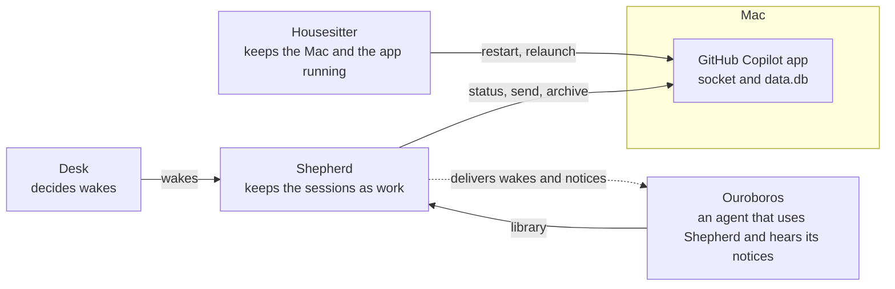

<!-- ourostack:brand:start -->
<p align="center">
  <a href="https://github.com/ourostack"></a>
</p>
<!-- ourostack:brand:end -->

# Shepherd

Keeps the flock: the GitHub Copilot app's sessions, as work.

Housesitter keeps the house: the Mac, and the app as a running process. Shepherd keeps the flock: the app's sessions. Each one is a small, separate job, and both talk to the app through the same library here.



## Duties

| Duty | Status |
| --- | --- |
| Which local sessions are busy or idle, and why | here now |
| How big each session's history is | here now |
| Send a session a message | here now |
| Archive a session or its workspace | here now |
| Compress an archived session's history (never a live one; restore-history brings it back) | here now |
| A safe point before a restart | moving here |
| Resume after a restart or crash | here now |
| The 500 MB resume cap | here now |
| Size watch and hand-off retirement | moving here |
| Stuck resume, and the six-hour health watch | here now |
| Billing account and quota | here now |
| Sidebar tidy | moving here |
| Waiting-prompt notices | moving here |
| Delivering Desk's wakes | moving here |

## CLI

```sh
npx github:ourostack/shepherd#v0.4.0 status                # one line per local session
npx github:ourostack/shepherd#v0.4.0 status --json         # the same as data
npx github:ourostack/shepherd#v0.4.0 restore-history <id>  # put back an archived session's compressed history
npx github:ourostack/shepherd#v0.4.0 watch --status        # what the health watch is following
npx github:ourostack/shepherd#v0.4.0 quota                 # each Copilot account's quota, and the balancer's last tick
npx github:ourostack/shepherd#v0.4.0 help
```

Read-only except `restore-history`, `watch`, `install` and an applied quota tick (its own state, log and waiting files). `quota read`, `quota plan` and `quota status` change nothing. Exit codes: 0 ok, 1 the app's data could not be read, the history could not be restored, or the agent could not load, 2 usage.

## Run it always

`shepherd install` writes `~/Library/LaunchAgents/bot.ouro.shepherd.plist` and loads it. The agent runs `shepherd watch --every 60 --quiet` and is kept alive, so every 60 seconds one pass runs the health watch and then the quota balancer, with no one at a terminal. Its log is `~/Library/Logs/shepherd-watch.launchd.log`. `shepherd install --dry-run` prints the plist and changes nothing.

The health watch follows each session that a resume sent a message to, for six hours. It asks a silent, erroring or stuck session once more, and tells the agent by name only about a session that stays broken.

## Quota balancing

No session stops on "You have exceeded your monthly quota" while a signed-in Copilot account still has premium requests left. The balancer reads each account's quota, moves a project off a spent account (or to the next account in a tranche order) by re-pinning it in the app, and messages the sessions that a quota error or the re-pin stopped mid-work. A project that is busy is never moved off a healthy account.

It is off until you configure it. Write `~/.config/shepherd/quota.json`:

```json
{
  "enabled": true,
  "repo_rules": [{ "repo": "work-org/*", "accounts": ["work-user@github.com", "user@github.com"] }],
  "account_rules": [{ "account": "work-user@github.com", "repos": ["work-org/*"] }],
  "prefer_unlimited": true
}
```

- `enabled`: only `true` turns the balancer on. With no file, or `false`, a tick does nothing.
- `repo_rules` and `account_rules`: which accounts may bill which repositories. Patterns use `*`. A project with no repository matches by name.
- `tranches` (default `[30, 60, 90, 100]`), `low_pct`, `out_pct`, `prefer_unlimited`, `respect_user_pins` and the other timing keys have defaults; see `DEFAULTS` in `src/quota.mjs`.
- `share` (optional): `{ "gist_id": "...", "gh_user": "..." }` reads other machines' readings from a gist.

Files, each overridable by an environment variable: the config (`SHEPHERD_QUOTA_CONFIG`), the balancer's state (`~/.config/shepherd/quota-balance.json`, `SHEPHERD_QUOTA_STATE`), the app's quota broadcasts (`~/.config/shepherd/quota-app.json`, `SHEPHERD_QUOTA_APP`), the list of projects waiting on a person (`~/.config/shepherd/waiting-on-operator.quota.json`, `SHEPHERD_QUOTA_WAITING`) and the decision log (`~/Library/Logs/shepherd-quota.jsonl`, `SHEPHERD_QUOTA_LOG`).

`shepherd quota read` shows each account's quota, `shepherd quota plan` shows what a tick would do now, and `shepherd quota status` shows the last applied tick. None of them change anything.

## Library

```js
import { deps, snapshot, sendTo, archive } from '@ouro.bot/shepherd';

const d = deps();   // defaults to ~/.copilot: the database, histories, socket, clock and ledger
const sessions = await snapshot(d);               // [{ id, title, state: 'busy'|'idle', why, workspaceId, ... }]
await sendTo(d, sessions[0].id, 'carry on', 10000);
await archive(d, { ...sessions[0], workspaceType: "worktree" }, { keepWorktree: false });
```

- `deps({ copilotHome, ledger, state })`: the app-facing deps (`copilotHome`, `sql`, `history`, `historySize`, `exchange`, `historyPath`, `gzip`, `gunzip`, `openBy`, `ledger`, `now`, `sleep`, `state`). `ledger` defaults to `$SHEPHERD_DISK_LEDGER`, else Housesitter's disk ledger; `state` defaults to `~/Library/Caches/shepherd`. Tests inject fakes in their place.
- `snapshot(deps, now?, skip?)`: every local, unarchived session, with `state`, `why` and `workspaceId`.
- `sendTo(deps, id, prompt, waitMs)`: `{ ok, error }`. A compressed history is restored first, best effort: a restore that can't run never stops the send.
- `archive(deps, row, { keepWorktree, waitMs, compress })`: `{ ok, error, compressed }`. Once the app confirms and its database shows the session archived, the history is compressed (`compress: false` skips it).
- `compressHistory(deps, id, { dryRun })` and `restoreHistory(deps, id)`: gzip an archived session's `events.jsonl` (never a live one, never an open one) and gunzip it back. Each compression appends a `history-compressed` row to the disk ledger.
- `exchange(copilotHome, messages, { done, keep, waitMs })` and `appReady(deps)`: one conversation with the app's socket.
- `resume(deps, { targets, startedAt, restartedAt, why, lanes, t, log })`: one resume message to each target, then a wait for its turn. `targets` is `pickTargets({ before, after, also })`, from the snapshots the caller took (after its `RESUME_T.grace` wait and its skip list). A history over the cap is held (`deps.heldBack`), never sent. When anything resumed, `<state>/resume-last.json` is written for the health watch. `resumeText({ at, why, lanes })` is the message; `RESUME_T` holds the default timings.
- `loopState`, `lastTurnAt`, `continuedSince`, `tookTurnSince`, `lastReply`, `readTail`, `READY`, `DEFER`: the pure readers of a session's history.
- `ShepherdError` carries `code`, `problem` and `fix`; its message reads `<problem>. Fix: <fix>.`
- `quotaConfig(file?)`, `quotaRead(deps, cfg?)`, `quotaTick(deps, { apply, only, cfg, now })`, `quotaStatus()` and `listenQuota(deps, { log, file, retryMs })`: the quota balancer (see Quota balancing). A tick with `apply` does nothing unless the config says `"enabled": true`.

Types ship in `src/index.d.ts`.

## Develop

`npm test` runs every test against fakes. Nothing touches a real app.
